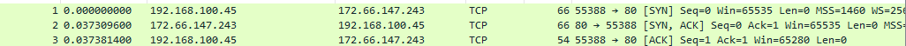

20261012(월) 수강노트

문제마다 할 일 → 왜 중요한가 → 이 문제에 나오는 말 → 순서를 읽습니다. 순서의 [창 이름]을 보고 지금 할 일을 어디서 하는지 확인합니다. 마지막 [보고서] 단계에서 보고서에 적습니다. 문제 앞의 상자는 🐍 문법 상자(파이썬) · 명령 상자(터미널) · Wireshark 상자 · 개념 상자입니다.

# Day 1 패킷 분석 보고서 (이름 · 2026-10-12)

> **쓰는 법**
> - 문제를 하나 풀 때마다 그 교시의 **문제 소제목 아래**를 채웁니다.
> - **값을 적는 줄**(끝이 `:`)은 콜론 뒤에 내 화면의 값을 씁니다.
> - **생각하는 질문**(물음표)은 아래 `답:` 뒤에, 내가 확인한 것과 그렇게 생각한 이유를 씁니다. 길어지면 다음 줄에 이어 써도 됩니다.
> - 🔍 는 그 교시에 배운 내용으로 답하는 핵심 질문입니다. 답을 못 찾았으면 「모름 — 막힌 곳: …」 을 씁니다.
> - ⭐ 도전은 선택이라 비워도 됩니다.

---

## 2교시 · ping 

### 문제 2-1 · 결과 화면 읽기

- 보냄 · 받음 · 손실 · 평균: 4, 4, 0, 35ms
- 손실 % 는 보낸 수와 받은 수로 어떻게 계산했나요? 
  - 답: 보냄, 받음의 평균을 분모, 보냄과 받음의 차를 분자로 하여 x100
    => 0

### 문제 2-2 · 구글 DNS 서버에 `ping` 열 번 보내기

- `8.8.8.8` 까지 평균 왕복 시간 · TTL · 받음 · 손실: 35ms, 115, 10, 10

### 문제 2-3 · 이름으로 `ping` 보내기

- `google.com` 의 IP 주소: 142.250.198.206
- 이름만 입력했는데 IP 주소가 나온 이유는 무엇인가요?
  - 답: DNS 조회로 알아낸 google.com의 IP 주소이다.

### 문제 2-4 · 두 가지 실패를 구별하기

- 두 실패 문구: 
ping abc.nowhere-not-exist
ping 192.0.2.1
- Ping 요청에서 abc.nowhere-not-exist 호스트를 찾을 수 없습니다. 이름을 확인하고 다시 시도하십시오.
- 요청 시간이 만료되었습니다.
- 192.0.2.1에 대한 Ping 통계:
    패킷: 보냄 = 4, 받음 = 0, 손실 = 4 (100% 손실)

- 두 실패는 각각 어디에서 멈춘 것인가요? 
  - 답: 1번 명령어는 호스트를 찾을 수 없어서 보낼 수 없었음.
        2번 명령어는 4번의 보냄에도 받음이 없어서 손실율을 보여주며 멈춘 것
  1번 - 이름 없음
  2번 - 응답 없음

### ⭐ 도전 2-5 · `ping` 결과를 파이썬으로 판정하기

ping_check.py

### 찾아본 것

- 2.1 표에서 찾아 쓴 TTL 의 뜻과 라우터를 지날 때 바뀌는 방식: 
- TTL은 IP 패킷이 네트워크에서 이동할 수 있는 홉 수를 제한하는 값이다. 라우터를 통과할 때마다 1씩 감소하며, TTL이 0이 되면 패킷은 폐기된다.

### 이 교시에 새로 안 것

- 이 교시에서 새로 알게 된 것: Ping, TTL, 손실율 측정하는 법, 실패를 구별하는 방법 등등 거의 모든 내용

---

## 3교시 · IP 와 MAC

### 문제 3-1 · 결과 화면 읽기

- 예시 화면의 IPv4 주소 · MAC 주소 · 기본 게이트웨이: 
- 192.168.100.45, D8-BB-C1-40-37-18, 192.168.1.1

### 문제 3-2 · 내 IP 주소 · 게이트웨이 · MAC 주소 찾기

- 찾은 장치 이름 · 내 IPv4 주소 · 기본 게이트웨이 · MAC 주소(물리적 주소):
이더넷 어댑터 이더넷 2, 192.168.100.45, 192.168.1.1, D8-BB-C1-40-37-18

### 문제 3-3 · 게이트웨이까지 `ping`

- 게이트웨이까지 평균 · 2-2 의 `8.8.8.8` 평균: 35ms
- 게이트웨이까지가 더 짧은 이유는 무엇인가요?
  - 답:기본 게이트웨이는 내 PC와 동일한 로컬 네트워크에 있는 공유기이므로 통신 경로가 짧아 평균 왕복 시간이 약 0ms로 측정되었다. 반면 8.8.8.8("google.com")은 외부 인터넷의 DNS 서버이므로 여러 네트워크 장비를 거쳐 통신하며, 평균 왕복 시간이 35ms로 더 길게 측정되었다.

### 문제 3-4 · ARP 캐시 보기 — `arp -a`

- 게이트웨이 줄의 MAC 주소 · 유형: 00-10-f3-a3-fc-96, 동적
- 🔍 ARP 는 무엇을 알아내려고 쓰나요? 내 결과의 게이트웨이 줄을 예로 들어 설명합니다.
  - 답: 

### ⭐ 도전 3-5 · 주소 모양으로 IP 와 MAC 구별하기

[VS Code] network_zt 폴더에 addr_kind.py를 만듭니다.
[VS Code] 아래 코드를 파일에 붙여 넣습니다.
[VS Code] 번호 주석 아래를 채웁니다.
[터미널] network_zt 폴더에서 python addr_kind.py를 실행합니다.

- 출력 첫 줄: 

### 이 교시에 새로 안 것

- 이 교시에서 새로 알게 된 것: arp -a

---

## 4교시 · 포트

### 문제 4-1 · 직접 실행해 보기

- 출력 두 줄: HTTPS, 모름
- `3389` 는 사전에 없는데도 에러 없이 둘째 줄이 나온 이유는 무엇인가요?
  - 답: 해당 키가 존재하지 않아서 모름이 출력됌.

### 문제 4-2 · 지금의 연결 보기 — `netstat -n`

- 고른 줄의 외부 포트 → 서비스 이름: 192.168.100.249:50271

### 문제 4-3 · 그 연결은 어느 프로그램의 것인가

- PID → 프로그램 이름: 9492, svchost.exe

### 문제 4-4 · 내 PC 의 LISTENING 포트 찾기

- 4.1 표에 있는 LISTENING 포트 → 서비스 이름: 135번 포트 RPC, 445번 포트 SMB
- 🔍 LISTENING 과 ESTABLISHED 는 무엇이 다른가요? 4-2 와 4-4 에서 본 줄을 예로 들어 설명합니다.
  - 답: 
  - LISTENING: 프로그램이 특정 포트에서
    새로운 연결 요청을 기다리는 상태.
  - ESTABLISHED: 두 장치 사이에 TCP 연결이
    수립되어 데이터를 주고받을 수 있는 상태.

### 문제 4-5 · 증상으로 층 좁히기

- 증상 ① · ② · ③ 에서 의심되는 층: 
1 - 7층, 이름을 IP로 해석하지 못함
2 - 1~3층 점검 필요, 물리적 연결부터 MAC, IP 설정 및 응답 확인
3 - 4~7층 점검 필요, ping을 사용하는 것으로 봐서, 3층까지는 점검이 되었지만, 4층 위의 계층의 점검이 필요함.
- 증상마다 그렇게 판단한 근거는 무엇인가요?
  - 답: 재기된 문제를 보고, 계층 구조별 특징을 근거하여 판단함.

### 찾아본 것

- 4.1 표에서 찾아 쓴 3389 의 위험과 445 를 이용해 퍼진 랜섬웨어: 

### 이 교시에 새로 안 것

- 이 교시에서 새로 알게 된 것:

---

## 5교시 · TCP

### 문제 5-1 · 직접 실행해 보기

- 출력 세 줄:
- 탐지 코드에서 플래그를 `==` 로 검사하면 어떤 일이 생기나요? 둘째 줄을 근거로 설명합니다.
  - 답: True
        False
        443
    근거: packet에 들어있는 flags가 벨류로는 SYN, ACK라는 리스트를 가지고 있기에, ""사용하여 문자열로 비교한다면, False가 나올 수 밖에 없다.
    그러면 제대로 된 통신 방식에 대해서 확인할 수 없다. 

### 문제 5-2 · TCP 일까 UDP 일까

- ① ~ ⑤ 가 각각 TCP · UDP · ICMP(ping) 중 무엇인지:
  - 답: 1.TCP, 2.UDP, 3.TCP, 4.UDP, 5.ICMP
- ① 사진 파일 보내기가 TCP 인 이유는 무엇인가요?
  - 답: 전송하고자하는 파일의 데이터가 일부라도 누락되면 안되기 때문이다.

### 문제 5-3 · 세 번의 순서 맞히기

- 세 패킷의 순서와 방향: 나 -> 다 -> 가
내 PC -> 서버, 서버 -> 내 PC, 내 PC -> 서버 
- 🔍 연결을 맺을 때는 세 번인데, 끝낼 때는 왜 네 번인가요?
  - 답: 마지막 ack을 서버가 받고, 연결된 상태(ESTABLISHED)에서 데이터를 주고 받은 후 PC에서 FIN을 보내면, -> 1번
  서버가 ACK을 보내고, FIN으로 완료됌을 전송한다, -> 2, 3번
  그러면 PC도 ACK을 다시 전송하기 때문이다 -> 4번

### 문제 5-4 · 같은 서버로 간 두 연결은 무엇이 다른가

- 두 연결에서 같은 것 · 다른 것: 
같은 것 -> 로컬 IP, 외부 IP, 외부 포트, 프로토콜 상태, 상태
다른 것 -> 로컬 임시 포트
- 같은 서버로 간 두 연결을 무엇으로 구별하나요?
  - 답: 외부 주소는 동일하나, 임시포트인 각 로컬 주소의 끝 포트번호만 다르다.

### 이 교시에 새로 안 것

- 이 교시에서 새로 알게 된 것: 3-way handshake, TCP, UDP의 차이점과 각 통신 방식의 개념

---

## 6교시 · Wireshark

### 실습 1 · 캡처하고 통신 방향 읽기

#### 문제 6-1 · Wireshark 실행하기

- 고른 인터페이스 이름: 이더넷 2

#### 문제 6-2 · 캡처한 통신의 방향 읽기

- `Packets` 숫자 · Protocol 열의 이름 세 개: 58개, ARP, MDNS, IPv6
- `숫자 → 443` 과 `443 → 숫자` 가운데 어느 줄이 요청인가요? 그렇게 판단한 이유는 무엇인가요?
  - 답: 숫자 -> 443
443은 HTTPS 포트로 암호화하여 전송한다.
Source가 내 PC의 IP이고, Destination이 서버의 IP인 것으로도 확인할 수 있다.

### 실습 2 · 패킷 내용을 해석하고 필터로 확인하기

#### 문제 6-3 · 패킷 하나를 층별로 펼치기

- Source MAC · Source IP / Destination IP · Time to Live · Source Port / Destination Port · Flags:

▶ Ethernet II
    Source: d8:bb:c1:40:37:18

▶ Internet Protocol Version 4
    Source Address: 192.168.100.45
    Destination Address: 172.64.155.209
    Time to Live: 128

▶ Transmission Control Protocol
    Source Port: 52563
    Destination Port: 443
    Flags: 0x010 (ACK)

- 이 패킷은 내 PC 가 보낸 것인가요, 받은 것인가요? 어떻게 알았나요?
  - 답: 이 패킷은 내 PC 임시포트를 통해 서버의 443번 포트로 패킷을 보냈다.
#### 문제 6-4 · 필터 결과와 뜻 비교하기

- 전체 `Packets` · `dns` · `udp` · `tcp.port == 443` 의 `Displayed`: 
- 필터를 걸어도 `Packets` 는 그대로인데 `Displayed` 만 바뀌는 이유는 무엇인가요?
  - 답:
  전체 packets : 300개
  dns : 0개
  dns의 displayed: 0개
  udp의 displayed: 122개
  tcp.port == 443의 displayed: 78개

### 이 교시에 새로 안 것

- 이 교시에서 새로 알게 된 것:

---

## 7교시 · 패킷 분석

### 문제 7-1 · 내 HTTP 연결 하나만 잡기

- 세 줄 Info 의 신호 순서: 

### 문제 7-2 · HTTP 요청과 연결 종료 찾기

- 요청 줄의 Info · FIN 줄 수: 
- 요청 줄의 Info: GET /?q=network_day1 HTTP/1.1
- FIN 줄 수: 2줄

- 🔍 내 검색어가 그대로 보인 것은 HTTP 이기 때문입니다. 같은 요청을 HTTPS 로 보냈다면 어떻게 보였을까요?
  - 답: HTTPS로 보냈다면 요청 내용이 암호화되어,
  Wireshark에서 검색어 network_day1을 평문으로 볼 수 없다.
  복호화 설정이 없다면 암호화된 TLS 데이터로 보인다.

### 문제 7-3 · 보고서 완성하고 올리기

- 깃허브 `network_zt` 폴더에 보고서가 보이나요:

### 이 교시에 새로 안 것

- 이 교시에서 새로 알게 된 것:

---

## 최종 분석 — 7교시에 완성합니다

> 오늘 잡은 **내 HTTP 연결 하나**를 처음부터 끝까지 정리합니다. 위에서 적은 6-3 · 7-1 · 7-2 의 답을 다시 보며 씁니다.

### 1. 연결이 열리는 순간 — 3-way handshake

- 세 줄의 Source → Destination 과 Info:
- 세 줄이 오간 뒤 두 컴퓨터는 어떤 상태가 되나요?
  - 답:

### 2. 패킷 하나를 열어 본 값 — 6-3

- 출발지 · 목적지 IP (3층) · TTL · 출발지 · 목적지 포트 (4층):
- 목적지 포트를 보고 어떤 서비스로 가는 패킷인지 알 수 있나요? 4.1 표를 근거로 설명합니다.
  - 답:

### 3. HTTP 요청 — 7-2

- 요청 줄에서 그대로 보인 내용:
- 이것이 보안에서 문제가 되는 이유는 무엇인가요?
  - 답:

### 4. 오늘 하루 정리

- 오늘 배운 것 가운데 가장 중요하다고 생각하는 것과 그 이유:
